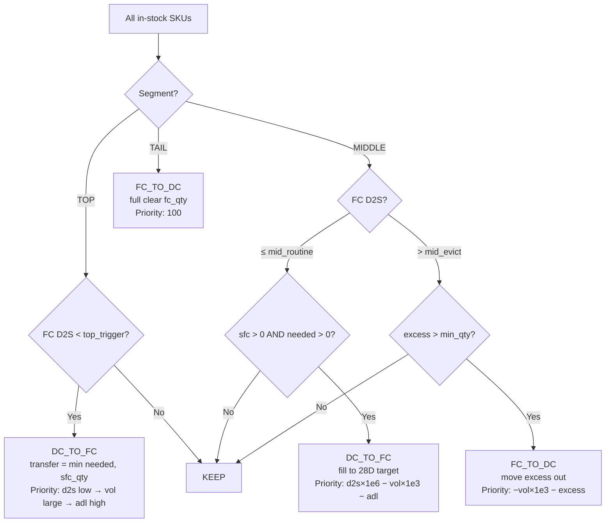

# Tab 3: Before vs After

**Purpose**: Shows the ideal state if all allocation rules were fully executed — comparing current inventory distribution vs the optimized target state.

## Ideal State Calculation (calc_ideal)

## Key Outputs

- `fc_ideal` / `sfc_ideal`: inventory after all transfers
- `fc_vol_ideal` / `sfc_vol_ideal`: volume after transfers
- `priority`: used for scheduling order

## Displayed Sections

1. **Overall Inventory Shift**: dual animated arrow diagram showing FC→SFC and SFC→FC movements with qty/vol
2. **By Segment cards**: per-tier SKU location changes (FC/SFC/Overlap) + qty + volume
3. **SKU Distribution bar**: before/after grouped bars
4. **SKU-level changes table**: filterable by tier and action

## Note on Ideal vs Plan

- **Before vs After** = unconstrained ideal state (infinite time, no daily cap)
- **Planning tab** = constrained by daily worker capacity
- Gap between the two = what requires extended timeline or more resources
