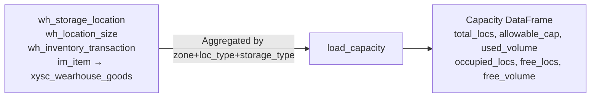

# Tab 4: Capacity

**Purpose**: Real-time FC and SFC warehouse capacity utilization — how much space is available vs used, broken down by storage type.

## Data Source

## Key Metrics per Row

| Field | Calculation |
|-------|-------------|
| `total_locs` | COUNT DISTINCT location_no |
| `total_volume` | SUM(wls.volume) |
| `allowable_cap` | SUM(volume × fill_rate) |
| `used_volume` | SUM(unit_vol × qty) per location |
| `free_volume` | allowable_cap − used_volume |
| `occupied_locs` | Locations with sku_vol > 0 |
| `free_locs` | total_locs − occupied_locs |

## Usage in Planning

`free_locs` and `free_volume` from FC are passed to `run_planning` as:
- `fc_free_locs`: initial available locations for DC→FC constraint
- `fc_free_vol`: initial available volume for DC→FC constraint

These grow each day as FC→DC releases locations.

## Exclusions

- `size_id IN (13, 33)`: excluded (non-standard sizes)
- `location_type IN (3, 4)`: Stock (3) and Bin Pick (4) only

## Displayed Sections

1. **FC and SFC summary cards**: allowable cap, used, free, utilization %
2. **Per loc_type bars**: Bin vs Stock breakdown with color-coded utilization
3. **Detail table**: filterable by zone and location type, with progress bar for Util%
4. **Utilization bar chart**: grouped by zone_type × storage_type × description
