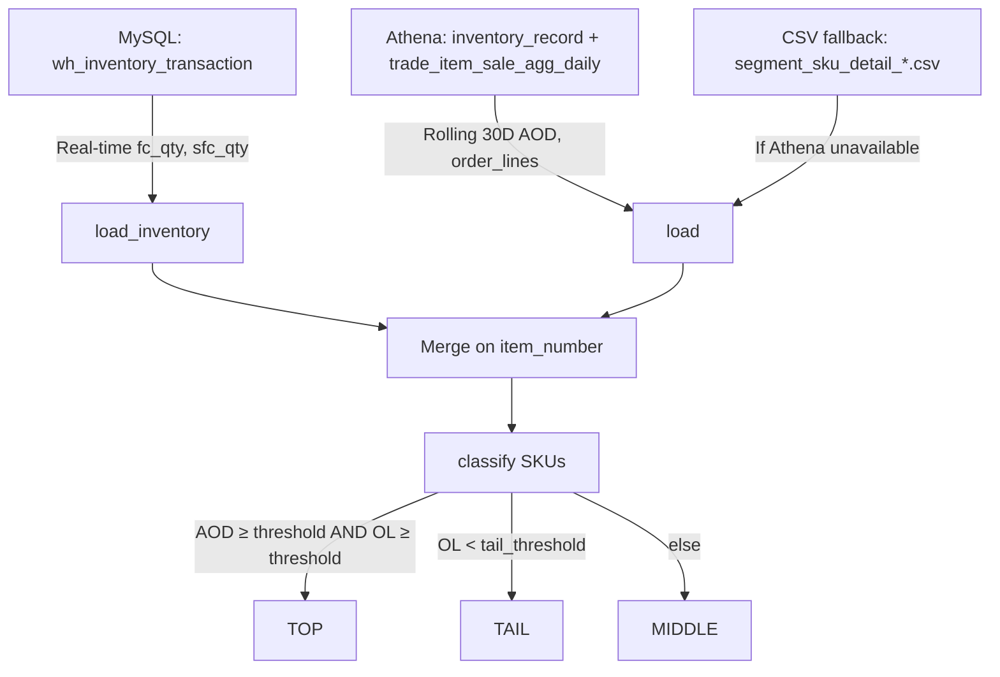
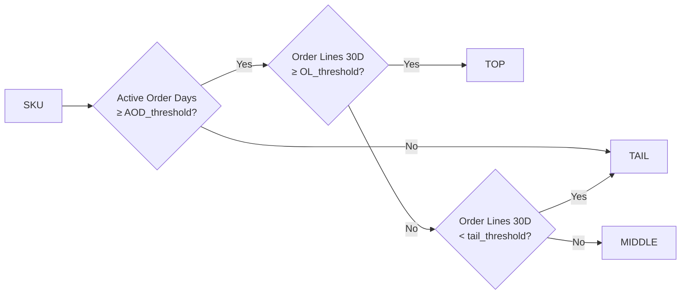

# Tab 1: Overview

**Purpose**: Shows current tier distribution (TOP/MIDDLE/TAIL) and how well the TOP tier meets business targets.

## Data Flow

## Segmentation Rules

## Displayed Metrics

- **Tier cards**: SKU count, OL%, Units%, Volume%
- **Donut charts**: SKU and OL distribution
- **Target bars**: TOP tier vs benchmark (SKU%, OL%, Units%, CBI%)
- **FC vs SFC stacked bar**: Inventory split by tier

## Parameters (Sidebar)

| Parameter | Default | Description |
|-----------|---------|-------------|
| Active Order Days ≥ | 21 | TOP trigger: minimum active selling days in 30D window |
| 30D Order Lines ≥ | 30 | TOP trigger: minimum order lines |
| 30D Order Lines < | 8 | TAIL trigger: low-velocity SKUs |
