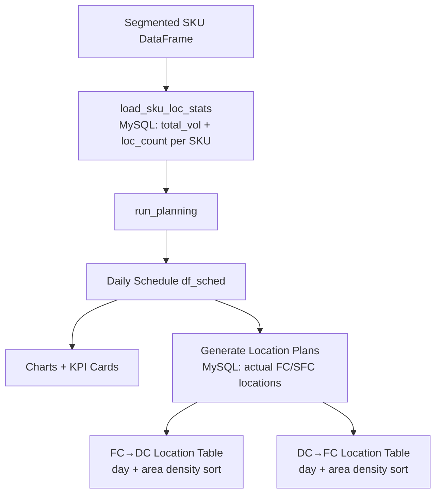
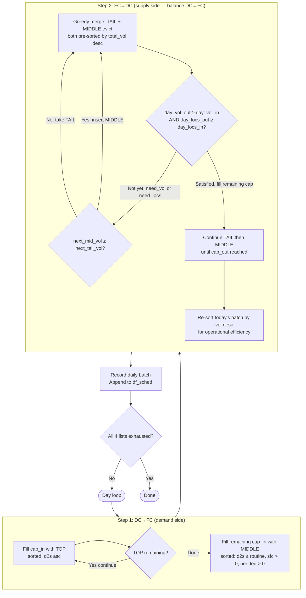
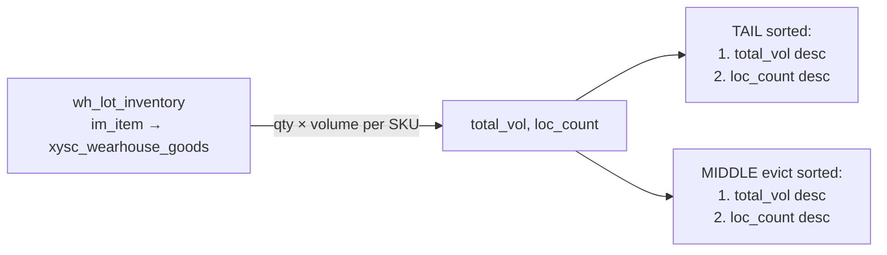
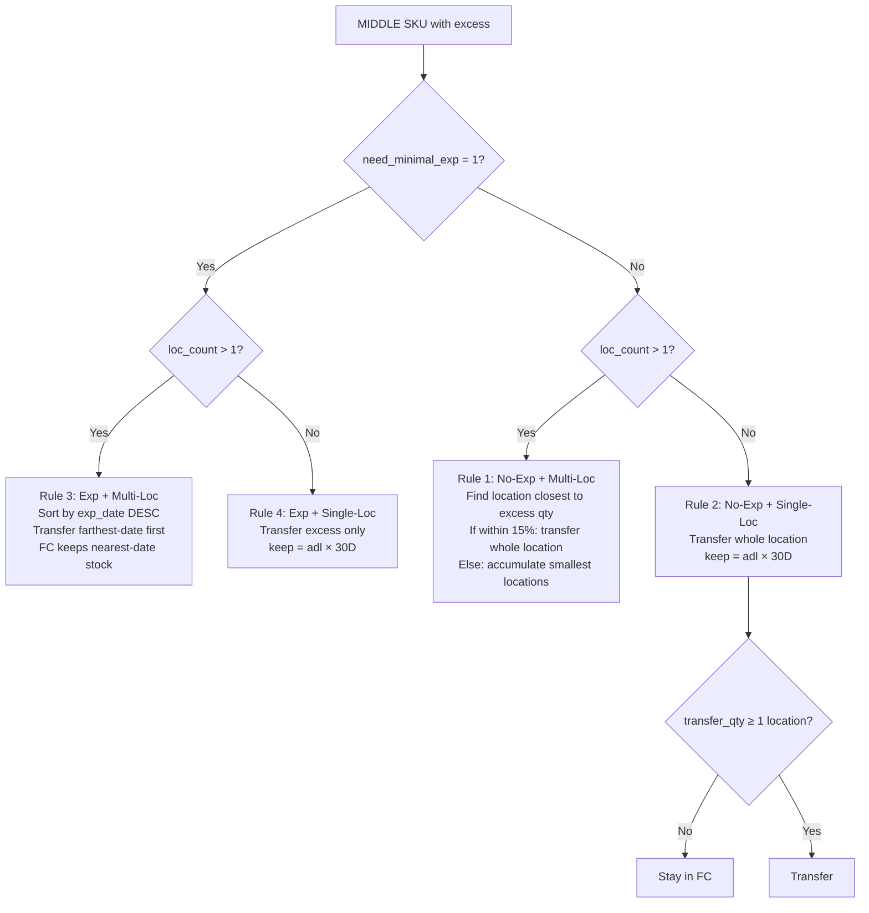

# Tab 5: Planning

**Purpose**: Generates a day-by-day transfer schedule respecting daily workforce capacity, with location-level operation plans.

## Overall Architecture



## Daily Schedule Algorithm



## TAIL Pre-Sorting (Real-time MySQL)



## FC Location Balance Constraint

```
day_locs_released = s_out (FC→DC locs today)
day_vol_released  = vol_out (FC→DC vol today)

DC→FC allowed only when:
  day_locs_in ≤ day_locs_released
  day_vol_in  ≤ day_vol_released
```

## MIDDLE FC→DC Location Selection Rules



## Parameters

| Parameter | Description |
|-----------|-------------|
| Workers FC→DC | Daily FC→DC headcount |
| SKU/person/day (FC→DC) | Productivity rate |
| Workers DC→FC | Daily DC→FC headcount |
| SKU/person/day (DC→FC) | Productivity rate |
| Tasks/person/day | Physical task limit |
| Pallets/task | Pallets handled per task |
| TOP trigger D2S | FC D2S below this → replenish from SFC |
| TOP target D2S | Target days of supply after replenish |
| MID routine D2S | MIDDLE replenish trigger |
| MID evict D2S | MIDDLE evict trigger (too much in FC) |
| Min loc qty | Skip transfer if excess < this value |

## Location Plan Generation

After schedule is computed, clicking **Generate Daily Location Plans**:

1. Extract SKUs per day from `df_sched`
2. MySQL: query actual FC lot locations (`wh_lot_inventory`) for FC→DC SKUs
3. MySQL: query actual SFC locations (`wh_inventory_transaction`) for DC→FC SKUs
4. Sort each day's locations by: **area density (prefix count desc) → location_no asc**
5. Output two tables with Day filter, SKU search, download CSV
