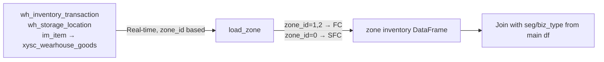

# Tab 2: Zone View (FC / SFC)

**Purpose**: Location-level inventory breakdown showing how inventory is distributed between FC and SFC zones, with SKU-level drill-down.

## Data Source

## Zone Definitions (NJ wh=002)

| Zone | zone_id | Prefixes | Description |
|------|---------|----------|-------------|
| FC | 1, 2 | B,C,G,H,J,K,S (zone 2) | Bin Pick zones |
| SFC | 0 | DC, K (stock) | Storage/DC zone |

## Displayed Sections

1. **Summary cards**: FC SKUs, SFC SKUs, Overlap SKUs
2. **Tier distribution charts**: SKU count and volume by tier for each zone
3. **Summary pivot table**: TOP/MIDDLE/TAIL × FC/SFC
4. **SKU-level detail table**: filterable by zone (FC/SFC/Both), tier, biz type

## Overlap Logic

Overlap = SKUs with qty > 0 in both FC and SFC simultaneously. High overlap indicates potential consolidation opportunities.
